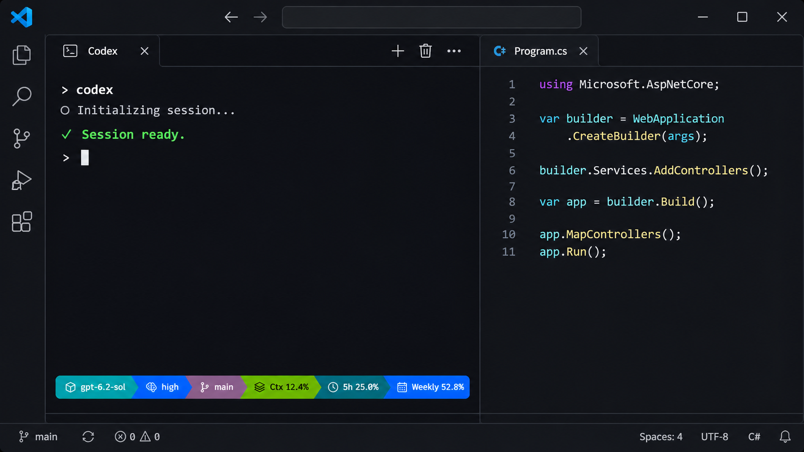

<div align="center">

# 

**A VS Code extension that brings the OpenAI Codex CLI and its Powerline status bar to your sidebar.**

Run Codex Powerline in a VS Code sidebar, with the same model, context,
usage limits, Git widgets, themes, and saved layouts as the CLI.

**Also supported in**

<a href="https://github.com/powerline-dev/codex-powerline-cli"> CLI</a> &nbsp; · &nbsp; <a href="https://github.com/powerline-dev/codex-powerline-visualstudio"> Visual Studio</a>

One Powerline CLI. The same layouts, themes, and widgets across all three hosts.

Give a ⭐ if this project helped you!

[](https://github.com/powerline-dev/codex-powerline-vscode)
[](https://github.com/powerline-dev/codex-powerline-vscode/forks)
[](https://github.com/powerline-dev/codex-powerline-vscode)

[](LICENSE)
[](https://code.visualstudio.com/)
[](https://nodejs.org/)

[](https://github.com/powerline-dev/codex-powerline-vscode/issues)
[](https://github.com/powerline-dev/codex-powerline-vscode/pulls)
[](https://github.com/powerline-dev/codex-powerline-vscode/graphs/contributors)



</div>

## 📥 Install

The downloadable extension packages target **Windows x64** and **macOS Apple silicon**,
with **VS Code 1.96.2 or newer**.

Both `codex` and `codex-powerline` must be on the PATH available to your IDE.
Restart your IDE after changes to Node.js or PATH.

### 🪟 Windows x64

**📦 Install and launch**

Install [Node.js 22.12 or newer](https://nodejs.org/en/download). In PowerShell, run:

```powershell
npm install --global @openai/codex @powerline-dev/codex-powerline-cli
codex login
codex-powerline configure
```

1. Install [Codex Powerline from Marketplace](https://marketplace.visualstudio.com/items?itemName=powerline-dev.codex-powerline-vscode).
2. Select **Codex Powerline** in the Activity Bar.

For manual installation, [download the Windows VSIX](https://github.com/powerline-dev/codex-powerline-vscode/raw/refs/heads/main/releases/0.2.3/codex-powerline-vscode-win32-x64-0.2.3.vsix)
and use **Extensions > ... > Install from VSIX...**.
You can move the view to the Secondary Side Bar to keep Explorer beside it.

**🔄 Update**

Use the **Extensions** view to update Codex Powerline from Marketplace. If you
installed from a VSIX, download the newer matching package from the
[release folders](releases/). Update the shared CLI separately:

```powershell
npm install --global @powerline-dev/codex-powerline-cli@latest
```

**🧹 Uninstall**

In **Extensions**, find **Codex Powerline**, select **Uninstall**, and reload VS Code.
To also remove the shared CLI:

```powershell
npm uninstall --global @powerline-dev/codex-powerline-cli
```

### 🍎 macOS Apple silicon

**📦 Install and launch**

Install [Node.js 22.12 or newer](https://nodejs.org/en/download). In Terminal, run:

```sh
npm install --global @openai/codex @powerline-dev/codex-powerline-cli
codex login
codex-powerline configure
```

1. Install [Codex Powerline from Marketplace](https://marketplace.visualstudio.com/items?itemName=powerline-dev.codex-powerline-vscode).
2. Select **Codex Powerline** in the Activity Bar.

For manual installation, [download the macOS VSIX](https://github.com/powerline-dev/codex-powerline-vscode/raw/refs/heads/main/releases/0.2.3/codex-powerline-vscode-darwin-arm64-0.2.3.vsix)
and use **Extensions > ... > Install from VSIX...**.
You can move the view to the Secondary Side Bar to keep Explorer beside it.

**🔄 Update**

Use the **Extensions** view to update Codex Powerline from Marketplace. If you
installed from a VSIX, download the newer matching package from the
[release folders](releases/). Update the shared CLI separately:

```sh
npm install --global @powerline-dev/codex-powerline-cli@latest
```

**🧹 Uninstall**

In **Extensions**, find **Codex Powerline**, select **Uninstall**, and reload VS Code.
To also remove the shared CLI:

```sh
npm uninstall --global @powerline-dev/codex-powerline-cli
```

### 🐧 Linux and other architectures

No prebuilt VSIX is included for these targets. Contributors can
[build on the target platform](docs/development.md). These targets need checks
on their own platform before release.

Removing the extension keeps the shared CLI. Removing the CLI keeps Codex,
your saved layouts, and installed fonts. Other Powerline hosts need the CLI.

## ✨ Features

- 💻 **Keep Codex close.** Chat, run commands, and use Codex in an interactive sidebar terminal.
- 🎨 **Make it yours.** Bring your CLI themes, presets, widgets, and saved layouts into VS Code.
- ⏱️ **Know what's left.** Keep the CLI's context usage and usage-limit widgets beside your code.
- 🌿 **Stay oriented.** Start in your active project folder and use the CLI's Git widgets to track your branch.
- 🔤 **Keep the Powerline look.** Bundled symbols give your separators the glyphs they need.
- 🧠 **Pick up where you left off.** Hide the sidebar and reopen it without losing the running session.
- 🔄 **Start fresh in one click.** Use **Restart Terminal** in the view header or the Command Palette.

The CLI owns the model, context, usage, and Git widgets. The extension hosts its
terminal. It does not contain a separate settings editor or widget engine.

## ⚙️ Configure

Pick your widgets, try a theme, and tweak your rows with the CLI's live preview:

```sh
codex-powerline configure
```

Save the layout, then run **Codex Powerline: Restart Terminal** in VS Code.
The terminal follows `terminal.integrated.fontFamily` and
`terminal.integrated.fontSize`, with the editor font as a fallback.

The [CLI repository](https://github.com/powerline-dev/codex-powerline-cli) contains
the settings schemas, migrations, themes, presets, widgets, and configuration skill.

In a multi-root workspace, the terminal uses the folder containing the active file,
or the first folder if no file is active. Without a workspace, it uses the active
local file's folder or your home folder.

## 🛠️ Troubleshooting

| Problem | What to check |
| --- | --- |
| The terminal cannot start | Run `codex-powerline run` in a normal terminal. Check that both CLIs are on PATH, then fully restart VS Code. |
| The layout is too narrow | Widen the sidebar or pick a compact layout with `codex-powerline configure`. |
| A new layout does not appear | Save it in the CLI editor, then use **Restart Terminal**. |
| VSIX does not match your platform | Download the matching package or build on your target platform. Native `node-pty` binaries are platform-specific. |

## 🤝 Contributing

Contributions are welcome! Open an issue, suggest a feature, or send a focused
pull request. See the [development guide](docs/development.md) for setup,
checks, and release preparation.

## Author and acknowledgments

**Martin Hájek** is the author and maintainer of Codex Powerline.

This extension uses [xterm.js](https://github.com/xtermjs/xterm.js) and
[node-pty](https://github.com/microsoft/node-pty).
See [NOTICE](NOTICE) for attribution.

## License

MIT. See [LICENSE](LICENSE) for the terms and copyright notices.
